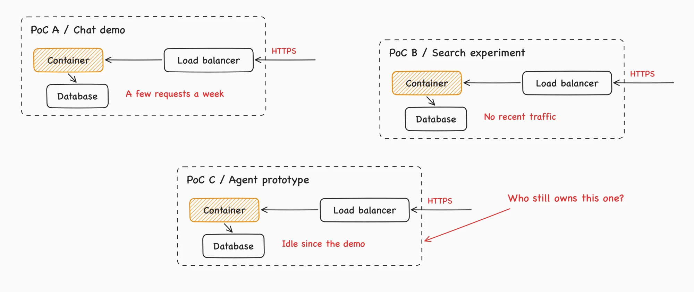

We are all using AI now. We have plenty of tools to generate apps and PoCs in a very simple and fast way, and people like data scientists, ML engineers and even product people are starting to program applications or want to run their own tests. For many of these tests, the pages that ChatGPT or Claude generate are enough, because they are static sites and they work pretty well to share inside an organization.

But then there is the other side: the PoCs that need services, databases and internal resources, and that many times people outside the infrastructure area want to deploy.

In the company where I work we started to see a good number of projects that needed databases and running instances behind a load balancer. The problem? Many of these people, even with agents, can’t deploy services in a secure way, because inside the company there are a lot of acceptance and security criteria before deploying anything, PoC or formal service. And we end up with these problems:

- Orphan services that nobody deletes.
- A bunch of roles and stacks duplicated across all the tests.
- A lot of time lost, error after error, creating the stacks and passing all the acceptance criteria, which of course an agent can’t catch on the first try.



So as the person responsible for infrastructure, **how do I make sure people can experiment fast without spending so many resources?**

---

## The Problem

We have some points in mind for every PoC:

- Follow the SRE and security rules.
- How long it will live.
- When it has to be on. Many PoCs don’t need to run every day or on weekends.
- Which internal resources it needs.
- Deploy in a cost-efficient way.
- Whether it can share resources with other PoCs.

And after the deploy, how do we keep control? If the PoC does its job, do we delete the resources or move it to a formal service?

Basically it’s very similar to a container auto-deploy system, but less demanding and with some advantages: we can share resources, and a PoC is meant to disappear.

---

## Why Not Let the AI Do Everything?

Someone could tell me: we have AI, let it do everything. The detail is that these AIs don’t know our internal libraries or our internal criteria. They can understand what is on the internet, but the context of the company is spread across many systems, and not even we have it together to hand it over.

The failure is a context failure. No matter how much we want an AI to do a deploy from zero following every readiness line, it’s very hard if we don’t have that context ourselves to feed it.

That’s why the proposal is to build a platform, or a guide as defined as possible, to solve these deploys only once, and then give the agents a simplified guide of how to deploy.

The platform is in charge of abstracting all these steps. Here I focus on the architecture of the proposal. Every company has its own requirements, but the architecture is very similar.

---

## The First Version: One Stack per PoC

What I’d call the PoC Platform needs basically three things: containers, shared resources and a shared base infrastructure.

The responsibility of the agent or the user is now only two things: a container image, and a file with the requirements of the PoC. For example:

```yaml
kind: PocService
metadata:
  name: hello-poc
spec:
  runtime:
    port: 8080
    healthCheckPath: /health
    cpu: '256'
    memory: '512'
  scaling:
    minTasks: 1
    maxTasks: 2
  resources:
    - type: documentdb
```

As we can see, we avoid writing subnets, roles, certificates, the load balancer and so on. All of that is already abstracted in the platform, so the user can’t get it wrong, and an agent can’t either.

A deploy needs three inputs:

- The descriptor.
- A container image pinned by digest, not by a tag that can change.
- The version of the infrastructure template.

The resources part is a list of needs, not of infrastructure. The descriptor says “I need a document database”. It doesn’t say how to build one, and a PoC never creates one.

The result is one stack per PoC. Each one has its own image, its own stack and its own private URL, and it deploys without touching the others.

The three main layers are:

- **Shared resources.** A database, a cache. Each one has its own pipeline and its own stack, and it exists before any PoC does. The platform doesn’t create them or delete them. It only knows where they are.
- **The foundation.** Roles, network access to those resources, and the automation for domains and access. It’s deployed once per environment.
- **The PoC stack.** The service, its URL, and its access to the resources it declared. It’s created and deleted many times.

So with these layers no PoC receives a database. It receives **access** to one that already exists, and when the PoC disappears the access is removed and the shared resource keeps going. That is the design. Today the pilot only has shared network access, and the per-PoC access is the part I describe below.

The deploy doesn’t care where the code comes from. The app can live in the same repo or be built somewhere else and only hand over an image. That second mode is designed, but I haven’t exercised it yet.

Today there are two PoCs running like this on ECS Express Mode and Fargate, sharing the network and the load balancer.

We end up with something like this:


---

## What AWS Gives You, and What I Had to Add

For this test we wanted to abstract several of those problems with ECS Express Mode, which is basically a simpler way to deploy on ECS. From an image it creates the service, and the routing rules, the autoscaling, the logs and the gradual deployment with its rollback alarm are already solved. It also reuses one load balancer for all the PoCs in the same network, up to 25 according to the docs, so we don’t create a different one for each.

So what was left for me?

- **A real name.** Express gives you a generated URL. To give each PoC a name under the internal domain, a small function adds that name to the load balancer rule, attaches the certificate, and removes it when the stack is deleted.
- **A contract.** The descriptor means teams don’t need to understand the template.
- **Shared identity.** Roles and the security group live in the foundation, so nobody creates them per app.
- **Consistent tags.** All tags come from one identifier and are declared only at the stack level. Declaring them on the service too made the deploy fail with duplicated keys.

One detail I wish I knew before starting: the first service you create in a network defines the subnets of the shared load balancer, and the next ones have to match. Pick the wrong subnets on the first one and you delete it and start again.

---

## Access Without Passing Secrets Around

Another thing to take into account: we have to manage the secrets to reach resources like databases.

If the PoC declares that it needs a database, nobody should create a user by hand or paste a password in a chat. The flow is the same one I use for the domain name, a small function that acts when the stack is created and cleans up when it’s deleted:

1. The descriptor declares the need.
2. The stack generates a password and stores it as a secret, named after the PoC.
3. The function creates a user for that PoC, with access to its own database and nothing else.
4. The container starts with the host, the user and the database as environment variables, and the password injected from the secret.

The app just reads five variables. Nobody sees the password, and nobody pastes it in a chat (we all have seen that).

The user and the database are derived from the PoC name inside the platform. The descriptor can’t choose them, and it can’t point at another PoC’s secret. When the PoC is deleted, the user and the secret go with it. The data stays, because dropping a database should be a decision and not a side effect of a rollback.

This part is written, but not deployed yet. It’s the first thing I turn on before accepting a PoC with real data.

---

## Scope Decisions: What I Left Out on Purpose

I kept the pilot small on purpose. These are the decisions I took, and how I’ll evaluate each one.

**Deploy isolation first, data isolation later.** The pilot proves that each app deploys and retires without affecting the others. Data access in the pilot is network-only and shared. Per-app credentials are the next deploy, and the network path stays shared after that: isolation is by credential, not by network.

**Shared by default, dedicated by exception.** A PoC that needs a database gets its own space inside an instance that already exists. A dedicated instance takes longer to create, costs money from minute one and doesn’t turn off at night, so it has to be justified. The same pattern applies to a SQL database or a cache when the first PoC asks for one.

**Scheduling is a cost hypothesis, not a feature.** At list prices, the shared load balancer costs about the same as the compute of two small services, and it doesn’t turn off at night. Spoiler: with two PoCs, night shutdown saves very little. It only makes sense with more apps, so before building it I’ll measure three things: whether the service can reach zero tasks, what happens when you deploy while it’s off, and how long it takes to come back.

**Being off has a user cost.** A request outside the schedule gets an error, because nothing wakes the service when traffic arrives. That’s fine for a demo and not for a formal service, so the schedule will be optional per app.

**The custom domain modifies a managed resource.** I chose it because it’s the simplest way to give each app an internal name. The risk is that this behavior isn’t documented, so the rule is reapplied on every new image deploy and the generated URL stays as a fallback.

**The end date is not built yet, and this is how I’ll do it.** The descriptor gets one more field, `expiresAt`, and the deploy writes it as a tag on the PoC stack. A scheduled job lists the stacks, warns the owner a few days before, and deletes the stack if nobody renews it. Deleting is already safe, because the stack removes its own URL, its access and its secret. What I still have to decide is the default: I’m thinking 30 days, renewable by changing one line.

**The success metric is adoption, not deployment.** Two running apps prove the design. It becomes a platform the day another team, or their agent, deploys without my help in less than half a day.

---

## Built for Agents Too

I said at the start that the failure is a context failure. This is where the platform helps.

A platform changes the question. The agent doesn’t need to understand our network, our roles, our DNS or our tagging rules. It needs to read one README and fill one descriptor with about ten fields.

Here’s what that means in practice:

- **Less context to load.** One contract instead of ten systems.
- **Rules in the template, not in the prompt.** An agent can’t forget to make the service private, because the descriptor doesn’t let it choose.
- **Same path for people and agents.** If a new engineer can follow the guideline, an agent can too.

I haven’t tested this yet. The next experiment is simple: give an agent only the README and the descriptor, and see if it can deploy a new PoC without me.

The idea is that we stop teaching every agent how the company works. We build the safe path once, and people and agents just follow it.

---

## Final Thoughts

1. **Start with the contract:** one descriptor, one image, one template version.
2. **Share what is boring:** network, load balancer, roles.
3. **Keep separate what is risky:** data access and credentials.
4. **Give every PoC an owner and an end date.**
5. **Write the guideline so an agent can follow it.**

Number four is the real difference with a production pipeline. Production assumes things live forever. A PoC should be born with an expiration date, and retire on its own if nobody renews it.

The goal isn’t to build another CI/CD system, but to make experiments cheap to start and easy to kill.
