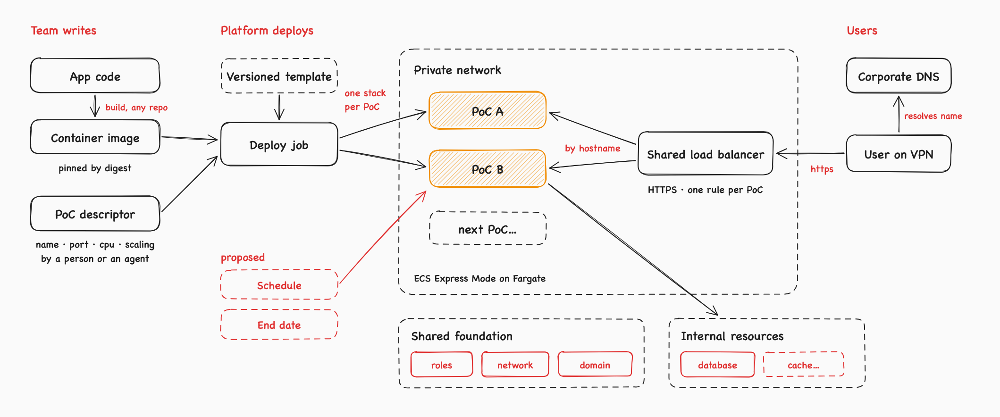

Building a PoC is not the hard part anymore. With AI tools, almost anyone can put together an app with a frontend and a backend in a couple of days: AI workflows, evaluation tools, chats, agents, internal experiments.

The hard part is what comes next. Somebody has to deploy it.

And that’s where the problems start:

- Services that stay on with nobody using them.
- Access to internal resources that nobody reviewed.
- Demos that are still alive months later, with no owner.

So as the person responsible for infrastructure, my question is simple: **how do we let people experiment fast without paying for it later?**

---

## The Problem

Imagine Ana, a data scientist with a working demo on her laptop. She needs a private URL for two weeks to show it to her team.

If I send her through the production process, the demo is old before it’s live. If I let her deploy however she wants, I get a new forgotten service every week.

These are the questions I want answered for every PoC:

- Does it follow our SRE and security rules?
- How long will it live?
- When does it need to be on? Most PoCs don’t need nights or weekends.
- Which internal resources does it need?
- What can it share with other PoCs?
- What happens after? If it works, do we delete it or move it to a formal service?

Yep, this looks a lot like any container auto-deploy system, and the mechanics are the same. The difference is the lifecycle: a PoC is less demanding than production, it shares resources by default, and it’s supposed to disappear.

---

## The First Version: One Stack per PoC

Let’s start with the contract. I ask the user for a short descriptor: name, port, health check path, CPU, memory, scaling, and the resources the app needs. That’s it.

This is the whole thing, trimmed of the internal identifiers:

```yaml
kind: PocService
metadata:
  name: hello-poc
spec:
  runtime:
    port: 8080
    healthCheckPath: /health
    cpu: '256'
    memory: '512'
  scaling:
    minTasks: 1
    maxTasks: 2
  resources:
    - type: documentdb
```

No subnets, no roles, no certificates, no load balancer. If a field is not there, the team can’t get it wrong.

A deploy needs three inputs:

- The descriptor.
- A container image pinned by digest, not by a tag that can change.
- The version of the infrastructure template.

The resources part is a list of needs, not of infrastructure. The descriptor says “I need a document database”. It doesn’t say how to build one, and a PoC never creates one.

The result is one stack per PoC. Each one has its own image, its own stack and its own private URL, and it deploys without touching the others.

That works because there are three layers, and each one changes at a different speed:

- **Shared resources.** A database, a cache. Each one has its own pipeline and its own stack, and it exists before any PoC does. The platform doesn’t create them or delete them. It only knows where they are.
- **The foundation.** Roles, network access to those resources, and the automation for domains and access. It’s deployed once per environment.
- **The PoC stack.** The service, its URL, and its access to the resources it declared. It’s created and deleted many times.

So a PoC never gets a database, it gets **access** to one that is already there. When we delete the PoC the access goes away, and the database doesn’t even notice.

The deploy doesn’t care where the code comes from. The app can live in the same repo or be built somewhere else and only hand over an image. That second mode is designed, but I haven’t exercised it yet.

Today there are two PoCs running like this on ECS Express Mode and Fargate, sharing the network and the load balancer.

We end up with something like this:



---

## What AWS Gives You, and What I Had to Add

Here I have to be fair with AWS: a lot of what looks like platform work is already done by Express Mode. From an image it creates the service, the load balancer with HTTPS, the routing rules, autoscaling, logs and a canary deployment with a rollback alarm. It also reuses the same load balancer for services in the same network, up to 25 according to the docs, with no extra charge on top of the resources.

So what was left for me?

- **A real name.** Express gives you a generated URL. To give each PoC a name under the internal domain, a small function adds that name to the load balancer rule, attaches the certificate, and removes it when the stack is deleted.
- **A contract.** The descriptor means teams don’t need to understand the template.
- **Shared identity.** Roles and the security group live in the foundation, so nobody creates them per app.
- **Consistent tags.** All tags come from one identifier and are declared only at the stack level. Declaring them on the service too made the deploy fail with duplicated keys.

One detail I wish I knew before starting: the first service you create in a network defines the subnets of the shared load balancer, and the next ones have to match. Pick the wrong subnets on the first one and you delete it and start again.

---

## Access Without Passing Secrets Around

A PoC that needs a database shouldn’t need a person to create a user and paste a password somewhere.

The flow is the same one I use for the domain name: a small function that acts when the stack is created and cleans up when it’s deleted.

1. The descriptor declares the need.
2. The stack generates a password and stores it as a secret, named after the PoC.
3. The function creates a user for that PoC, with access to its own database and nothing else.
4. The container starts with the host, the user and the database as environment variables, and the password injected from the secret.

The app just reads five variables. Nobody sees the password, and nobody pastes it in a chat (we all have seen that).

The user and the database are derived from the PoC name inside the platform. The descriptor can’t choose them, and it can’t point at another PoC’s secret. When the PoC is deleted, the user and the secret go with it. The data stays, because dropping a database should be a decision and not a side effect of a rollback.

This part is written, but not deployed yet. It’s the first thing I turn on before accepting a PoC with real data.

---

## Scope Decisions: What I Left Out on Purpose

I kept the pilot small on purpose. These are the decisions I took, and how I’ll evaluate each one.

**Deploy isolation first, data isolation later.** The pilot proves that each app deploys and retires without affecting the others. Data access in the pilot is network-only and shared. Per-app credentials are the next deploy, and the network path stays shared after that: isolation is by credential, not by network.

**Shared by default, dedicated by exception.** A PoC that needs a database gets its own space inside an instance that already exists. A dedicated instance takes longer to create, costs money from minute one and doesn’t turn off at night, so it has to be justified. The same pattern applies to a SQL database or a cache when the first PoC asks for one.

**Scheduling is a cost hypothesis, not a feature.** At list prices, the shared load balancer costs about the same as the compute of two small services, and it doesn’t turn off at night. Spoiler: with two PoCs, night shutdown saves very little. It only makes sense with more apps, so before building it I’ll measure three things: whether the service can reach zero tasks, what happens when you deploy while it’s off, and how long it takes to come back.

**Being off has a user cost.** A request outside the schedule gets an error, because nothing wakes the service when traffic arrives. That’s fine for a demo and not for a formal service, so the schedule will be optional per app.

**The custom domain modifies a managed resource.** I chose it because it’s the simplest way to give each app an internal name. The risk is that this behavior isn’t documented, so the rule is reapplied on every new image deploy and the generated URL stays as a fallback.

**The end date is not built yet, and this is how I’ll do it.** The descriptor gets one more field, `expiresAt`, and the deploy writes it as a tag on the PoC stack. A scheduled job lists the stacks, warns the owner a few days before, and deletes the stack if nobody renews it. Deleting is already safe, because the stack removes its own URL, its access and its secret. What I still have to decide is the default: I’m thinking 30 days, renewable by changing one line.

**The success metric is adoption, not deployment.** Two running apps prove the design. It becomes a platform the day another team, or their agent, deploys without my help in less than half a day.

---

## Built for Agents Too

There is one more reason I like this approach, and it’s not about cost.

Most PoCs today are written with coding agents. They are very good at writing the app. They are not good at knowing how *your* company deploys things.

The model is not the problem here. The missing context is.

In a big company the knowledge is everywhere: repositories, documentation, pipelines, tracing, deployment systems. No agent has all of that, and probably never will. A big part of an engineer’s job today is pointing the agent to the right place.

A platform changes the question. The agent doesn’t need to understand our network, our roles, our DNS or our tagging rules. It needs to read one README and fill one descriptor with about ten fields.

Here’s what that means in practice:

- **Less context to load.** One contract instead of ten systems.
- **Rules in the template, not in the prompt.** An agent can’t forget to make the service private, because the descriptor doesn’t let it choose.
- **Same path for people and agents.** If a new engineer can follow the guideline, an agent can too.

I haven’t tested this yet. The next experiment is simple: give an agent only the README and the descriptor, and see if it can deploy a new PoC without me.

The idea is that we stop teaching every agent how the company works. We build the safe path once, and people and agents just follow it.

---

## Final Thoughts

1. **Start with the contract:** one descriptor, one image, one template version.
2. **Share what is boring:** network, load balancer, roles.
3. **Keep separate what is risky:** data access and credentials.
4. **Give every PoC an owner and an end date.**
5. **Write the guideline so an agent can follow it.**

Number four is the real difference with a production pipeline. Production assumes things live forever. A PoC should be born with an expiration date, and retire on its own if nobody renews it.

The goal isn’t to build another CI/CD system, but to make experiments cheap to start and easy to kill.
